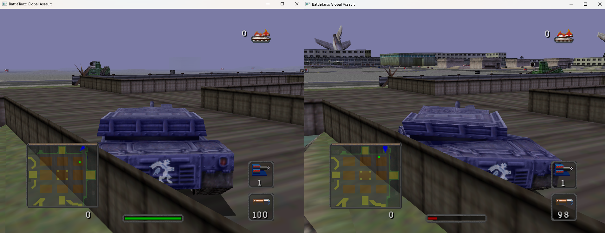
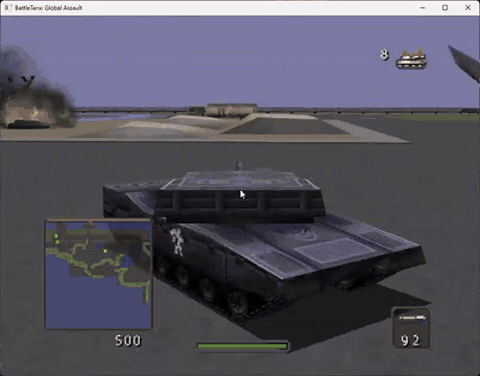

# BattleTanx: Global Assault — native PC port

[](port/pc/README.md)
[](https://github.com/TheGh0stShip/BattleTanx-Global-Assault-PC-Port/releases/latest)
[](COPYING)

This repository is the definitive native PC port of **BattleTanx: Global
Assault**, built from the completed matching Nintendo 64 decompilation. The
Windows runtime boots the original game, renders through RT64/Direct3D 12,
plays audio through SDL2, supports keyboard and SDL game controllers, and has
been played through the original menus into campaign gameplay. Linux uses
RT64's Vulkan backend.

The port uses N64Recomp for the recovered CPU program, RSPRecomp for audio
microcode, N64ModernRuntime for N64 operating-system services, and RT64 for
display-list rendering. It is a native host executable—not an emulator bundle.
The completed byte-matching decompilation remains in this repository as the
auditable source and compatibility foundation. Matching-decompilation work is
developed upstream in
[TheGh0stShip/BattleTanx-Global-Assault](https://github.com/TheGh0stShip/BattleTanx-Global-Assault);
this repository owns the PC runtime, compatibility patches, packaging, and PC
release validation.

No ROM or ROM-derived assets are included. Supply your own legally obtained dump.

## Playable PC port demonstration

[](https://www.youtube.com/watch?v=PrhwXBr1qJI)

The video above demonstrates the game running as a native Windows executable
from this repository: original menus and campaign gameplay,
RT64 Direct3D 12 rendering, SDL audio, and live keyboard input. Click the image
to play the full demonstration on YouTube.

## PC port status

- Native Windows x64 executable with Direct3D 12 rendering.
- Native Linux build path with Vulkan rendering.
- Original menus and campaign gameplay are playable.
- Keyboard and SDL game-controller input, rumble, and SDL audio are connected.
- Original 4:3, match-window, 16:9, 16:10, 21:9, and 32:9 renderer projection
  modes are selectable; game-specific HUD and split-screen validation remains
  in progress.
- Default-off gameplay mods provide extended fog-free visibility and
  independent turret aiming with dual sticks or mouse and keyboard.
- Native Controller Pak persistence uses standard 32 KiB `.mpk` images in a
  stable per-user directory, compatible with common N64 emulator pak images.
- RT64's live developer inspector is available by setting
  `BTGA_RT64_DEVELOPER=1` and pressing F1.
- Distribution packages are ROM-free; the player supplies a verified local
  USA Rev 0 `.z64` dump at launch.
- Native PC host/client transport passes an automated public relay test in both
  directions. The runtime has an experimental two-player controller-sync path;
  automatic state reconciliation and full-screen per-device cameras remain in
  development.

This is still a development port. Long-session stability, every game mode,
representative GPUs/controllers, in-game save-flow validation, and visual
effects remain part of the release validation matrix.

The current verified Windows package is available from the
[latest GitHub Release](https://github.com/TheGh0stShip/BattleTanx-Global-Assault-PC-Port/releases/latest).

## Controls

| Action | Keyboard / mouse | Controller |
|---|---|---|
| Drive / steer | **W A S D** | Left stick |
| N64 A / primary fire | **X** or **left mouse button** | A button |
| N64 B | **Z** | X button |
| N64 Z trigger | **Left Shift** | Left trigger |
| Start / pause | **Enter** | Start |
| N64 L / R | **Q / E** | Left / right shoulder |
| D-pad | Arrow keys | D-pad |
| C buttons | **I J K L** | Right stick |
| Aim down turret / capture mouse | **Hold right mouse button** | Move right stick |
| Fire while aiming | **Left mouse button** | A button |
| Open or close PC settings | **F10** | — |

The settings overlay can also be closed with its **Close** button or window
**X**. After closing it, press **F10** again to reopen it. Controls can be
rebound from **F10 → Controllers**.

With the optional independent-turret mod enabled, hold **right mouse button**
and move the mouse to aim the turret; **left mouse button** fires. The right
stick aims the turret on a controller. Releasing right mouse returns to the
selected retail control behavior. Keyboard and controller input can be used at
the same time.

See the [complete controls guide](docs/CONTROLS.md) for menu operation,
controller defaults, multiplayer assignments, rebinding, and the distinction
between the F10 settings overlay and the optional F1 renderer inspector.

## Optional gameplay mods

Open **F10 → Mods** to enable these features. Both are **off by default**, so
the game retains its original Nintendo 64 behavior until you opt in.

### No Fog / Increased Draw Distance

Enable **Extended visibility** to remove the game's distance fog and raise its
world-culling and projection distance. This exposes substantially more of each
level at once. Some distant geometry may become visible that the original game
never expected to draw simultaneously.



*No Fog / Increased Draw Distance enabled in the native PC port.*

### Aim-Down-Turret / Independent Turret Aiming

Enable **Independent dual-stick turret aiming** to control a rotating turret
separately from the vehicle hull:

- **Mouse and keyboard:** hold **right mouse button** to enter aim-down-turret
  mode, move the mouse to rotate the turret, and press **left mouse button** to
  fire. Release right mouse to leave aim mode.
- **Controller:** drive with the left stick and aim the turret with the right
  stick.
- While aim mode is held, W/S move along the hull heading and A/D turn the
  hull. A turret aimed east does not force a north-facing hull to turn east.
- Mines, gun buddies, bouncing betties, and other deployables preserve their
  original behavior rather than following turret aim.

Sensitivity and inversion options are available under **F10 → Controllers**.
See the [complete controls guide](docs/CONTROLS.md#independent-turret-aiming-mod)
for full details.



*Aim-Down-Turret demonstration: the turret remains independently aimed while
the vehicle moves and turns on its hull heading. [Watch the complete mod
demonstration on YouTube](https://www.youtube.com/watch?v=dkHIju1Jj2s).*

## Build and run the PC port

The complete native-runtime guide is in [port/pc/README.md](port/pc/README.md).
On Windows, use a native NTFS checkout with Git for Windows and Visual Studio
2022's **Desktop development with C++** workload. One PowerShell command
verifies your local ROM, downloads and builds the pinned dependencies,
generates the ignored translation output, builds the native x64 executable,
and launches it:

```powershell
Set-ExecutionPolicy -Scope Process Bypass
./port/pc/setup-windows.ps1 -Rom 'C:\Games\BattleTanxGA.z64' -Run
```

Subsequent code-only rebuilds can use `port/pc/build-windows.ps1`. The complete
manual and Linux setup paths are in
[port/pc/recomp/README.md](port/pc/recomp/README.md).

Create a ROM-free distributable ZIP with:

```powershell
./port/pc/package-windows.ps1 -BuildDirectory build-pc-windows -Version 0.2.1
```

Add `-Portable` to create a separately named USB-ready archive containing the
portable-mode marker:

```powershell
./port/pc/package-windows.ps1 -BuildDirectory build-pc-windows -Version 0.2.1 -Portable
```

Optional gameplay mods, RT64 texture packs, Linux/headless commands, save
locations, renderer diagnostics, and packaging contents are documented in the
[PC runtime guide](port/pc/README.md).

Portable installations are supported by placing an empty `portable.txt` next
to `BattleTanxGA.exe`; all writable data then stays in a neighboring
`userdata` directory.

## Supported ROM

- Title: `BATTLETANXGA`
- Region/revision: USA, Rev 0 (`NBQE`)
- Format: big-endian `.z64`
- Size: 8 MiB
- SHA-1: `805248fb0a0ee694cad8d7dc927b631d860dd8cf`
- SHA-256: `88268ce770ff39f2ca839848b842c87866df6c5ddaf775f180b2522c18ff6221`

## Reproduce the original N64 build from your own ROM

```sh
python3 tools/reproduce.py /absolute/path/to/BattleTanxGA.z64
```

The input must be an existing local big-endian `.z64` dump. The command
verifies it before use, installs pinned local toolchains, compiles the recovered
source, extracts the complete ignored resource tree, rebuilds the full 8 MiB
cartridge image, and runs the code, asset, hash, test, and repository-safety
gates. Generated assembly is intentionally ignored; reviewed C, authentic RSP
assembly, and project metadata are the source of truth.

See [the complete reproduction and resource guide](docs/REPRODUCING.md) for
individual stages, output paths, editing/repacking commands, prerequisites,
and the reusable region-manifest interface.

For native-port resource packaging, see the [O2R runtime-resource
path](docs/O2R_PORT_PATH.md). It records what is genuinely structured today
and prevents container-only `.o2r` claims without runtime resource factories.

## Source foundation

The PC runtime carries a snapshot of the recovered N64 source and the tooling
needed to validate and translate a user-supplied ROM. Matching progress and
source-recovery work are tracked only in the upstream
[BattleTanx: Global Assault decompilation](https://github.com/TheGh0stShip/BattleTanx-Global-Assault).
This repository's CI and status describe the PC port itself.

## Repository map

- `port/pc/` — native Windows/Linux runtime, compatibility hooks, build scripts,
  Controller Pak support, tests, and ROM-free packaging.
- `src/code/<subsystem>/` — recovered game source. Identified units use
  `ADDRESS_descriptive_name.c`; genuinely anonymous units use `ADDRESS.c` in
  `src/code/unknown/`. `config/source_layout.tsv` is the authoritative path and
  address catalogue. Run `make check-source-names` to enforce it.
- `src/libmus/`, `src/n_audio/`, and `src/libultra/` — recovered middleware and
  SDK runtimes, kept separate from game-owned source and retaining authentic
  upstream-style names where known.
- `src/asm/` — reviewed source assembly such as RSP and microcode material;
  generated assembly is ignored.
- `config/us/` — ROM layout, symbol, ownership, and matching-evidence tables.
- `decompkit/` — reusable Python library for ROM regions and resource tooling.
- `tools/` — project-facing build, extraction, verification, and reporting
  entry points.
- `tests/` — portable synthetic tests that do not require copyrighted assets.
- `docs/` — architecture, compiler, matching, provenance, asset-format, and
  tooling references.

One incidental discovery from the source recovery: rodata at `0x80072694`
contains developer-credit Easter-egg strings including “Murray likes fries.”

See also the [reusable decompilation toolkit](docs/DECOMPKIT.md),
[reproduction and resource guide](docs/REPRODUCING.md),
[tool and test map](docs/TOOLS.md),
[source-maturity and naming policy](docs/SOURCE_MATURITY.md),
[native-port architecture](docs/NATIVE_PORT.md),
[reproducible matching research](docs/MATCHING_RESEARCH.md),
[library fingerprints](docs/LIBRARIES.md), [asset formats](docs/ASSET_FORMATS.md),
[compiler notes](docs/COMPILER.md), and
[research provenance](docs/PROVENANCE.md).

Cross-platform multiplayer is developed independently in
[BattleTanx-Global-Assault-Networking](https://github.com/TheGh0stShip/BattleTanx-Global-Assault-Networking).
The portable GPLv3 protocol and relay client are pinned into this build but
remain dormant: constructing or launching the game performs no network access.
The native PC transport has been tested end to end through the public master
and relay. **F10 → Online** now browses, hosts, and joins real public relay
lobbies and exchanges original controller ports 1 and 2. The current path is
experimental: both peers must begin from the same retail menu state, and state
recovery plus full-screen local cameras are not finished. Live
service status is available at
[`btga.thegh0stship.com`](https://btga.thegh0stship.com/).
Opening the Online tab itself remains network-inert; Refresh, Host, and Join are
the explicit opt-in actions.

## License

Project-authored code and imported GPL research are licensed under GPL-3.0; see `COPYING`. BattleTanx: Global Assault and its game data remain the property of their respective rights holders.
